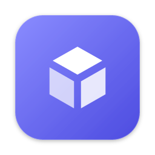

<p align="center">
  
</p>

<h1 align="center">Tessera Launcher</h1>

<p align="center">
  A Minecraft launcher for modpacks, friends and your own servers.<br>
  <a href="https://github.com/lephorx/Tessera-Launcher/releases/latest"><b>Download</b></a> ·
  <a href="https://github.com/lephorx/Tessera-Launcher/releases">Releases</a> ·
  <a href="https://tesseralauncher.com">tesseralauncher.com</a> ·
  <a href="https://github.com/lephorx/Tessera">Tessera server manager</a>
</p>

Tessera is **invite-only** for now: you need an invite link from someone who's in to create an account. Playing offline works without one.

- **Play** Vanilla, Fabric, Quilt, Forge and NeoForge; Java is installed for you.
- **Mods and modpacks** from Modrinth, `.mrpack` import and export, and Tessera's own `.tapack`.
- **Share** an instance with friends by username or link; let them play it or also add content; hand it over to someone else.
- **Servers**: create a server from an instance on your [Tessera](https://github.com/lephorx/Tessera) machine; it keeps the instance's server-side mods in sync and joins with one click.
- **Skins**, a library with groups and search, news, friends, and automatic updates.

## Download

Get the newest version from [Releases](https://github.com/lephorx/Tessera-Launcher/releases/latest) (macOS for Apple silicon and Intel, Windows, Linux). The launcher updates itself: when a new version is out, the top bar shows **Reload to update**.

The builds aren't signed with an Apple or Microsoft certificate yet. On macOS, right-click the app → **Open** the first time; on Windows, choose **More info → Run anyway**.

## Releasing

Push a version tag; GitHub Actions builds and signs every platform in parallel and publishes the release. Every push to `main` also runs the same release build to keep the build cache warm, so tag builds only recompile the launcher itself. The tag's message becomes the release notes and a post in the launcher's News.

```sh
# bump "version" in launcher/package.json, launcher/src-tauri/Cargo.toml and tauri.conf.json, then
git tag -a v0.3.0 -m "What's new in this version"
git push origin v0.3.0
```

Needs the repository secrets `TAURI_SIGNING_PRIVATE_KEY` and `TAURI_SIGNING_PRIVATE_KEY_PASSWORD` (the updater key; the launcher only installs updates signed with it). Microsoft sign-in needs the repository variable `TESSERA_MS_CLIENT_ID`, the Azure app's client ID; for a local build, set it in the environment.

## Background

This repo started as the concept for the next stage of [Tessera](https://github.com/lephorx/Tessera) (formerly CSCM): one account for players and server owners, a launcher with modpacks that sync to your servers, and two ways to get a server (do it yourself, or hosted later).

## Documents

| | |
|---|---|
| [01 Vision](docs/01-vision.md) | What it is, for whom, the two options, user journeys |
| [02 Architecture](docs/02-architecture.md) | CSCM Cloud, agents on each machine, pairing, security |
| [03 Launcher](docs/03-launcher.md) | The desktop app: play, modpacks, server sync, hosting on this device |
| [04 Installer & setup](docs/04-installer-and-setup.md) | One-click install per OS, beginner setup wizard, Playit-only |
| [05 Changes to CSCM](docs/05-cscm-changes.md) | Everything that has to change in the CSCM repo |
| [06 Dependencies](docs/06-dependencies.md) | Tech stack, libraries, external APIs and services, approvals |
| [07 Hosted tier](docs/07-hosted-tier.md) | Plans, sleeping servers, routing, abuse, billing, legal |
| [08 Roadmap](docs/08-roadmap.md) | Phases and milestones |
| [09 Open questions](docs/09-open-questions.md) | Decisions to make before building |
| [10 UI design](docs/10-ui-design.md) | Look exactly like the dashboard: Modern and Classic, tokens, components, screenshots |

## Repositories

| Repo | What |
|---|---|
| [`lephorx/Tessera`](https://github.com/lephorx/Tessera) | The server manager (agent + local dashboard), formerly CSCM. Stays usable on its own. |
| [`lephorx/Tessera-Launcher`](https://github.com/lephorx/Tessera-Launcher) | This repo (pnpm monorepo): [`launcher/`](launcher/) (desktop app), [`cloud/`](cloud/) (accounts and sharing API on Neon) and the concept docs. |
