# 10 UI design — match the Tessera dashboard

The launcher and the cloud dashboard must look **exactly like the CSCM dashboard**, in both of its looks: **Modern** and **Classic**. A user who switches between the browser dashboard and the launcher should not be able to tell where one ends and the other begins.

- **Source of truth:** CSCM `frontend/app/globals.css` plus the components in `frontend/components/` (CSCM 1.9.3). This document describes them; when the dashboard changes, this document and [`ui/tokens.css`](ui/tokens.css) change in the same week.
- **Cloud dashboard:** reuses the CSCM frontend itself (open question 10), so it matches automatically.
- **Launcher:** a Vue 3 fork of the Modrinth App, so the React components can't be reused. It reuses the **tokens** ([`ui/tokens.css`](ui/tokens.css), same variable names) and rebuilds the components to the specs below.

## Reference screenshots

All at 1440×900, taken with [`ui/screenshot.py`](ui/screenshot.py) (mocked API, same data every time).

| | Modern, dark | Modern, light | Classic |
|---|---|---|---|
| Servers | 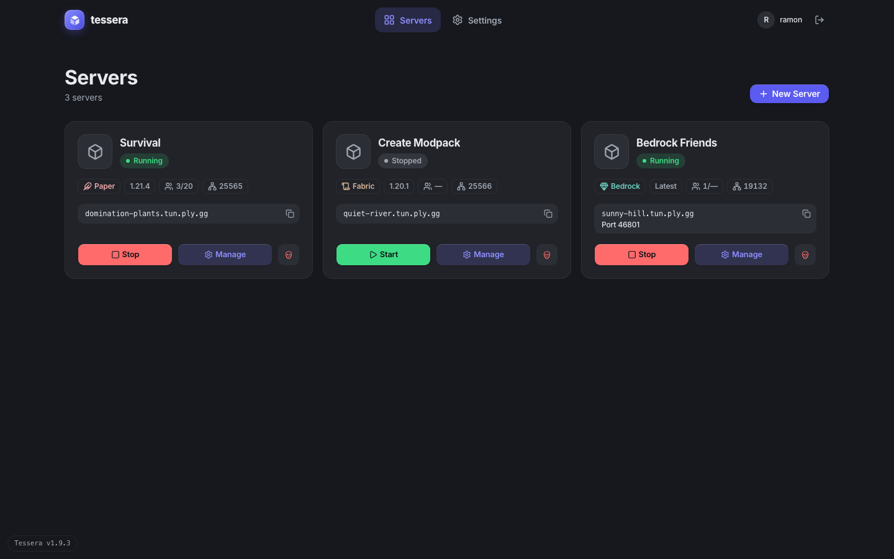 | 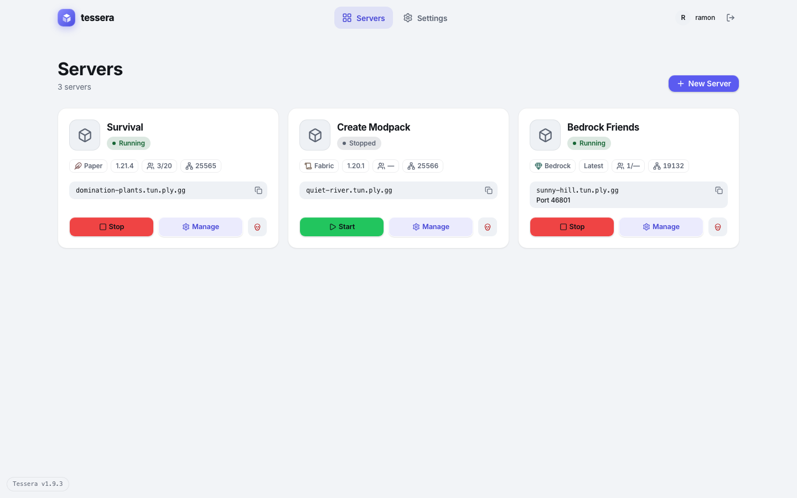 | 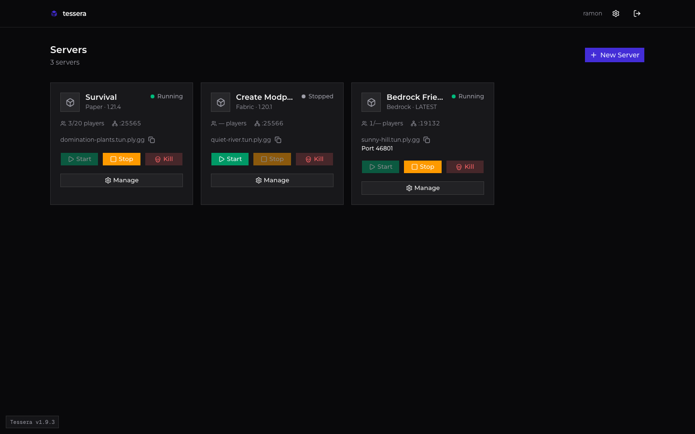 |
| Server page | 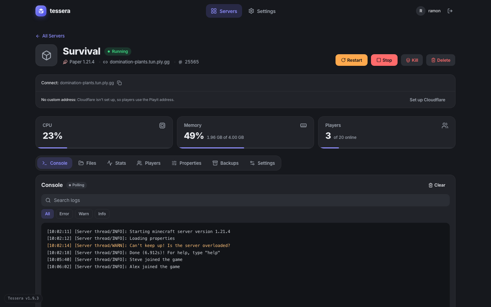 | 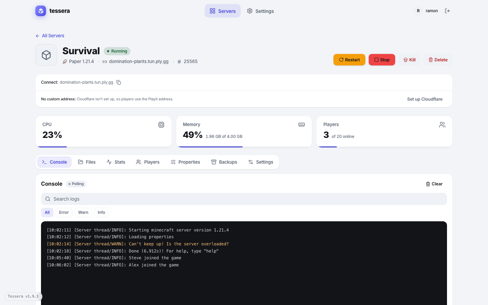 | 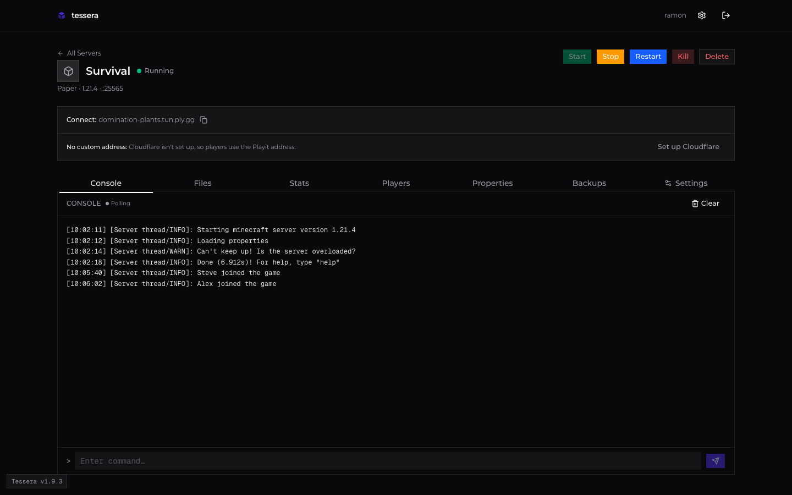 |
| Settings | 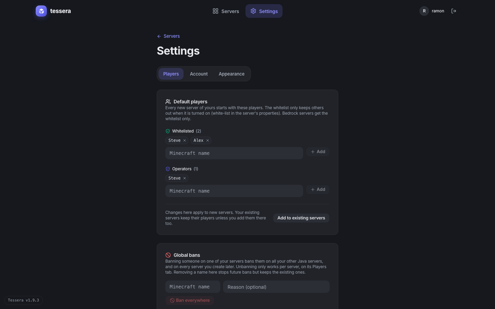 | 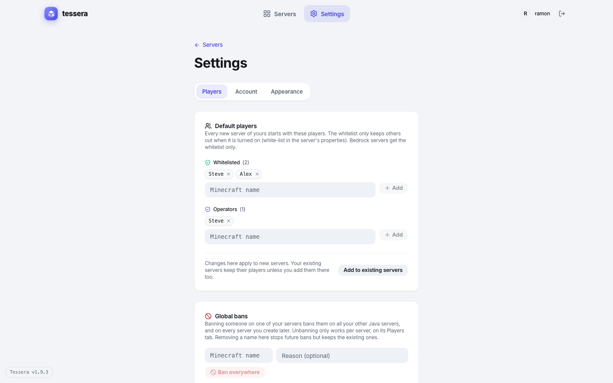 | 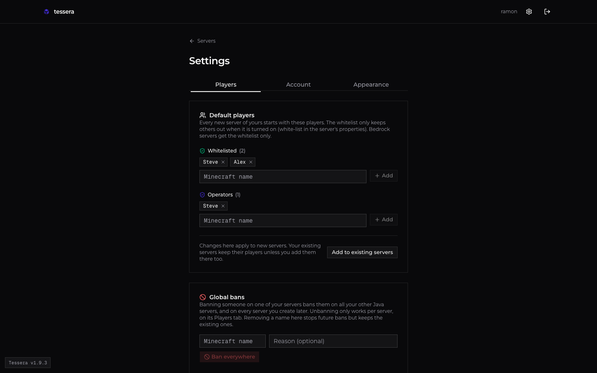 |
| Sign-in | 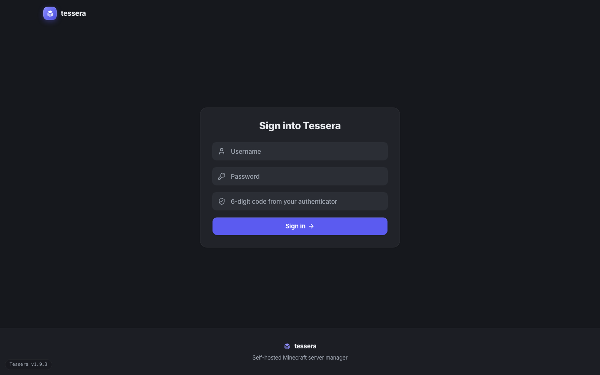 | 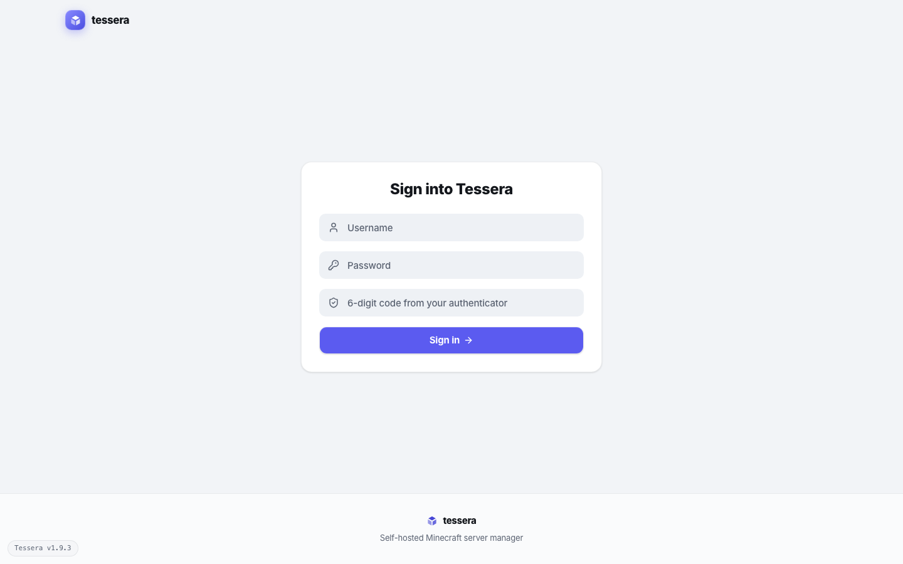 | 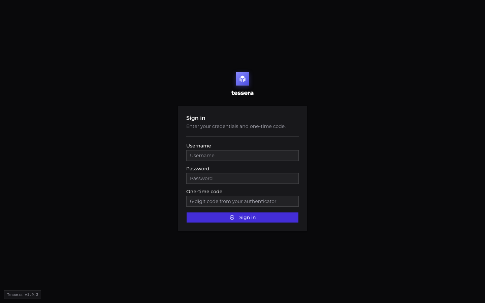 |

## 1. The two looks

| | Modern (default) | Classic |
|---|---|---|
| Feel | Rounded, layered charcoal surfaces, bold type, soft motion | The original look: square, flat, always dark, compact |
| Light / dark | Follows the device setting | Always dark |
| Font | Inter (body 14 px, letter-spacing −0.011em, headings −0.02em) | Montserrat |
| Mono font | ui-monospace / SF Mono / Menlo | Geist Mono |
| Radius | `--radius: 0.75rem`; cards 16 px, buttons 12 px, fields 10 px | `0` everywhere except dots and avatars |
| Accent | Indigo `#5b5bf0` (dark ring `#7b7bff`, active text `--tint`) | Indigo-700 `oklch(0.457 0.24 277)` ≈ `#432dd7` |
| Depth | Layers: background < card < inset (`--surface-2`) < field in inset (`--surface-3`); light mode adds a faint shadow | Flat cards with a 10 % white border |
| Motion | Page and tab slides, button lift and squish, staggered entrances | None beyond color changes and pulsing dots |

### How a look is chosen (copy this behaviour)

- The choice is stored per device: the dashboard uses `localStorage["cscm-design"]` = `"modern"` | `"classic"`; the launcher stores the same value in its settings. Later the cloud can sync it per account.
- It is applied on the root element **before the first paint** (the dashboard runs an inline boot script in `<head>`; the launcher must do the same in `index.html` so it never flashes the other look):
  - `data-design="modern|classic"`
  - class `dark` when classic, or modern and the OS is dark; listens to `prefers-color-scheme` changes live
  - `color-scheme: dark|light`
- Switching cross-fades the whole window with a view transition (320 ms) unless reduced motion is on.
- Settings → Appearance shows the two options as cards with a small drawing of each look and a round check mark (CSCM `DesignPanel.tsx`). The launcher gets the identical picker.

Styles are written as "classic by default, `modern:` overrides". In the dashboard that's the Tailwind variant `modern:` (`[data-design="modern"] &`). In the launcher use the same pattern: base styles = classic, `[data-design="modern"]` selectors on top.

## 2. Colour tokens

Full values: [`ui/tokens.css`](ui/tokens.css). The ones you'll use most:

| Token | Modern light | Modern dark | Classic | Used for |
|---|---|---|---|---|
| `--background` | `#f2f4f7` | `#16181d` | `#09090b` | Window |
| `--card` | `#ffffff` | `#212329` | `#18181b` | Cards, panels |
| `--surface-2` / `--fill` | `#eef1f5` | `#2b2e35` | = muted `#27272a` | Insets, fields, quiet buttons, chips |
| `--surface-3` | `#ffffff` | `#363a42` | — | Fields inside an inset |
| `--popover` | `#ffffff` | `#2b2e35` | `#18181b` | Dialogs, menus, toasts |
| `--foreground` | `#14171c` | `#e8eaee` | `#fafafa` | Text |
| `--muted-foreground` | `#5b6372` | `#a2a9b4` | `#9f9fa9` | Secondary text, icons |
| `--primary` | `#5b5bf0` | `#5b5bf0` | `#432dd7` | Main buttons, progress |
| `--tint` / `--tint-bg` | `#4646d6` / 12 % indigo | `#8f8fff` / 18 % indigo | = primary | Selected nav, active tab, "Manage", links |
| `--destructive` | `#b91c1c` | `#ff6b6b` | `#ff6467` | Kill, delete, errors |
| `--border` | 8 % slate | 6 % white | 10 % white | Hairlines |

**Status colours** (state badges, meters). Modern uses `--status-*` (text/dots) and `--fill-*` (big filled buttons, always with dark `--on-fill: #0e1116` text). Classic uses fixed Tailwind colours:

| State | Modern dark (light) | Classic dot |
|---|---|---|
| Running | green `#3ddc84` (`#166534`) | `emerald-500` |
| Starting / Restarting | blue `#6aa5ff` (`#1d5fd6`), radiating ring | `sky-500` / `blue-500`, pulsing |
| Stopping | orange `#ffa94d` (`#9a3f07`), radiating ring | `amber-500`, pulsing |
| Unhealthy | red `#ff6b6b` (`#b91c1c`) | `red-500` |
| Stopped / Not created | gray `#a2a9b4` (`#5b6372`) | `zinc-400` |

**Server type colours** (chip icon; text too in dark), the way Modrinth tags loaders:

| Paper | Purpur | Fabric | Forge | Vanilla | Bedrock | other |
|---|---|---|---|---|---|---|
| `#eeaaaa` Feather | `#c39dff` Zap | `#dbb69b` Scroll | `#959eef` Hammer | `#7dd87d` Box | `#6fd2c3` Gem | `#a2a9b4` Box |

In light mode the icon is mixed 55 % with black so it stays readable. The launcher adds **NeoForge** and **Quilt** with new colours in the same pastel range; add them to CSCM's `Chip.tsx` too.

## 3. Typography

| Element | Modern | Classic |
|---|---|---|
| Page title (Servers, Settings) | 32 px bold, tight leading | 20 px semibold |
| Server title | 28 px extrabold | 20 px semibold |
| Card title | 17 px bold | 16 px semibold |
| Section title (Console, Default players) | 16 px bold | 12 px medium uppercase, wide tracking, muted |
| Body | 14 px | 14 px |
| Secondary / meta | 12–13 px semibold, muted | 12 px, muted |
| Stat value | 26 px extrabold, `tabular-nums` | — |
| Brand word "tessera" | 17 px extrabold, lowercase | 14 px semibold, lowercase |

Numbers that change (ports, players, percentages) always use `font-variant-numeric: tabular-nums`. Icons are [Lucide](https://lucide.dev) (`lucide-vue-next` in the launcher), 16 px default, 14 px in small buttons, 18 px in the nav, stroke 2 (1.75 in stat cards).

## 4. Layout

- **Content width:** max 1280 px (`max-w-screen-xl`), 24 px side padding, centred. Settings content is narrower (~528 px column).
- **Top bar:** modern 64 px, sticky and translucent (`material`: background at 72 % + 20 px blur + saturate 180 %); its bottom hairline only appears once content scrolls under it. Classic 56 px, solid, always a bottom border.
  - Left: logo. Modern: 32 px rounded tile with gradient `#8a8aff → #4b4be0`, white cube mark, indigo glow shadow, then "tessera". Classic: small indigo cube mark, then "tessera".
  - Centre (modern only): nav pills "Servers", "Settings", 40 px high, 12 px radius; current = `--tint-bg` background + `--tint` text. The launcher adds **Play / Library / Discover** here.
  - Right: avatar letter in a round `--fill` circle, username, "admin" pill, ghost icon buttons (check for updates, sign out). Classic: plain username text, settings gear, sign out.
- **Page header:** title + subtitle (e.g. "3 servers") left, primary action right; modern has 40 px top padding and aligns the action to the bottom of the title.
- **Server grid:** 1 → 2 (≥640 px) → 3 (≥1024 px) columns, 16 px gap; classic goes to 4 columns at ≥1280 px.
- **Version badge:** small mono pill bottom-left ("Tessera v1.9.3").
- **Update banner:** full width, fixed to the bottom, amber `bg-amber-400` with `text-amber-950`, warning triangle, dark "Update" button.

## 5. Surfaces

Modern turns every `border + bg-card` box into a **rounded surface** (16 px radius, `--surface-shadow`). A box inside a card is an **inset**: 14 px radius, no border, `--surface-2` fill, never a second outlined card. Fields and quiet buttons inside an inset step up to `--surface-3` so they don't melt in. An inset inside an inset goes back to `--card`.

Classic: every box is square, `--card` with a 1 px `--border`; nested boxes are the same.

## 6. Components

### Buttons

| Variant | Modern | Classic |
|---|---|---|
| Primary | `--primary`, white text, 12 px radius, semibold, inset top highlight + glow in its own colour on hover | `--primary`, square, medium |
| Outline / secondary | No border, `--fill` background, hover `foreground/10` | Bordered, transparent, hover muted |
| Ghost | Transparent, hover `--fill` | Transparent, hover muted |
| Destructive | `destructive/10` background, destructive text | `destructive/20` background, destructive text |
| Link | `--tint` text | `--primary` text, underline on hover |

Sizes: default 32 px high (12 px side padding in modern), sm 28 px (10 px radius), action buttons on cards and the server header 36 px. Modern interaction: hover lifts 1 px and brightens 5 % (15 % in dark), icon scales 1.12 with a spring; press squishes to 0.94 for 60 ms and springs back. Disabled = 50 % opacity.

**Server actions** (keep these exact pairings, they're how users read state):

| Action | Modern | Classic |
|---|---|---|
| Start | `--fill-green`, dark text, play icon | `emerald-600`, white |
| Stop | `--fill-red`, dark text, square icon | `amber-500`, white |
| Restart | `--fill-orange`, dark text, rotate icon | `blue-600`, white |
| Kill | `--fill` square icon button, destructive skull | `destructive` variant with label |
| Manage | `--tint-bg` + `--tint` text, gear icon | Full-width outline button under the actions |
| Delete | Destructive text, hover `destructive/15` | Outline with destructive border and text |

Modern shows only the action that fits the state (Start **or** Stop), with Manage beside it and Kill as a square icon at the end. Classic shows Start, Stop and Kill side by side and disables what doesn't apply.

### Fields

Modern: 36 px high, 10 px radius, no border, `--fill` background; on focus the fill goes transparent and a `--ring` border + 3 px ring/50 appears. Classic: 32 px, square, 1 px `--input` border, `input/30` background. Leading icons (search, user, key, shield) sit 12 px from the left in muted colour. Checkboxes and radios use `accent-color: var(--primary)`.

### Tabs

- **Modern:** segmented control: a 44 px card (`--card`, 16 px radius, 4 px padding, surface shadow) holding 13 px semibold triggers with icons; the active one gets a `--tint-bg` pill that **slides** to the new tab, text `--tint`. Scrolls sideways on small screens.
- **Classic:** full-width underline tabs, active one has a light underline and white text.
- Switching tabs slides the panel in the direction of travel (see Motion).

### Status badge

Modern: 24 px capsule, status colour at 15 % behind status-coloured text, 6 px dot; busy states (starting, stopping, restarting) radiate a ring from the dot. Classic: 8 px dot + muted text, pulsing when busy. The label always names the state; colour is never the only cue.

### Chips

24 px high, 8 px radius, 1 px border, 12 px semibold muted text, optional 14 px icon (type colour). On a server card: type, version ("Latest" for LATEST), players `3/20`, port. Classic shows the same info as a muted line "Paper · 1.21.4" plus an icon row.

### Server card

Anatomy, top to bottom: icon (modern 56 px / 14 px radius; classic 40 px square) + name + state badge → chips → connect address in an inset with a mono address and a copy button (Bedrock adds "Port 46801") → actions. Owner line ("Owner: alex") when an admin sees someone else's server. While being created or deleted, an overlay covers the card (`card/90`, spinner or trash icon, step text, 180 px progress bar, percentage; red bar for delete) and the card is inert. Modern cards lift 2 px with `--hover-shadow` on hover.

### Stat cards (modern)

Three across: label + icon top, big value + detail ("1.96 GB of 4.00 GB"), 3 px meter along the bottom edge in `--tint`, red at ≥90 %; width animates over 700 ms.

### Console

Dark log well in both looks: modern `#121418`, 12 px radius, 12.5 px mono, line height 1.65, text `#d4d8de`, WARN lines `#ffc27a`, ERROR lines `#ff8a8a`; search field and level filter (All / Error / Warn / Info) above it. Classic: `zinc-950` box, 12 px mono, `zinc-200` text, no filter bar. A "Polling" or "Live" dot sits next to the title.

### Dialogs

Modern: 20 px radius, 24 px padding, `--popover` background, `--raised-shadow`, backdrop black/35 with a 2 px blur, opens with a 380 ms ease-out zoom from 95 %. Classic: square, 16 px padding, 1 px ring, black/10 backdrop, 100 ms fade + zoom. Footer: Cancel (outline) left of the main action. Confirmations for Stop/Kill/Delete always say what will happen.

### Switches

Modern: 38×22 px, checked = `--status-green` (iOS-like), white 18 px knob with a small shadow, sheet easing. Classic: 32×18 px, checked = `--primary`.

### Toasts

Sonner at the bottom right, `--popover` background, `--border`, the look's radius. Icons: check (success), info, triangle (warning), octagon-X (error), spinner (loading).

### Loading

Modern shows **skeletons** in the exact shape of the content (6 px radius shimmer between `--fill` and 6 % foreground, 1.4 s). Classic shows a centred 24 px spinner.

### Sign-in

The layout differs between the looks; see the screenshots.

- **Modern:** site bar with the logo only; a centred 480 px card titled "Sign into Tessera" (24 px extrabold, centred); fields **without labels**, each with a leading icon (user, key, shield) and a placeholder; full-width primary "Sign in →" button; a footer band (one step lighter than the background) with the logo and "Self-hosted Minecraft server manager".
- **Classic:** no top bar; the logo tile (40 px, indigo gradient, glow) with "tessera" under it, centred; a square card below it with "Sign in" + "Enter your credentials and one-time code.", a separator, **labelled** fields (Username, Password, One-time code), and a full-width primary button with a shield icon.

In the launcher, "Sign in with Microsoft" (for the game) and the Tessera Cloud account sign-in use this same screen, with the Microsoft button as a secondary full-width button under the primary one.

### Code and file editor

CodeMirror 6 with the GitHub Dark theme in both looks; languages by file extension (JSON, YAML, properties, TOML, JS, Python, shell, logs with WARN orange and ERROR red).

## 7. Motion (modern only)

| What | How |
|---|---|
| Curves | standard `cubic-bezier(.4,0,.2,1)`, out `(.22,1,.36,1)`, spring `(.34,1.56,.64,1)`, sheet `(.32,.72,0,1)` |
| Durations | fast 140 ms (colours), 220 ms (moves), 420 ms (springs, entrances) |
| Page entrance | content rises 10 px and fades in, 420 ms; lists **stagger** 40 ms per item up to 240 ms |
| Page change | view transition on the page content only (nav bar stays): deeper pages slide in from the right (out −32 px, in from +48 px), going back mirrors it, sideways fades up 12 px. Old page leaves in 140 ms, new arrives over 440 ms after 80 ms |
| Tab change | panel slides 18/28 px in the direction of travel, 120 ms out, 360 ms in; the tab pill slides |
| Hover | cards lift 2 px with a larger shadow; buttons lift 1 px |
| Press | buttons squish to 0.94, tabs/nav/switches to 0.95 |
| Design switch | whole-window cross-fade, 320 ms |

Rules: once a page transition has run, pages don't replay their own entrance; content that loads later just fades in. Clicks are never blocked during a transition.

## 8. Accessibility (both looks)

- Contrast: text 13–16:1, secondary text ≥5.3:1 on every surface, white on indigo 5.2:1, dark text on green/orange/red fills ≥5.0:1.
- `prefers-reduced-motion`: no movement (entrances, slides, squish off); colour and opacity changes stay.
- `prefers-contrast: more`: stronger borders and secondary text (in `tokens.css`).
- `prefers-reduced-transparency`: the translucent top bar becomes solid `--card`.
- Visible focus ring (`--ring`, 3 px at 50 %) on everything focusable; icon-only buttons have labels and titles.

## 9. Building it in the launcher

1. Import [`ui/tokens.css`](ui/tokens.css) globally and **replace** the Modrinth App theme variables with ours (map their `--color-bg`, `--color-raised-bg`, `--color-button-bg`, `--color-brand` … to `--background`, `--card`, `--fill`, `--primary` …). Remove Modrinth's green brand colour everywhere.
2. Bundle Inter and Montserrat (and Geist Mono) locally; no Google Fonts requests from the app.
3. Boot the look before the first paint (`index.html` inline script, same logic as the dashboard's `DESIGN_BOOT_SCRIPT`); Appearance setting with the same two cards.
4. Build a small Vue component set mirroring the dashboard: `Button`, `Input`, `Tabs` (with the sliding pill), `Dialog`, `Switch`, `Chip`/`TypeChip`, `StateBadge`, `ServerCard`, `StatCard`, `Console`, `CopyButton`, `Skeleton`. Same props, same names, same `data-slot` attributes so the shared CSS rules apply.
5. Pages that exist in both apps (server list, server page and its tabs, settings, sign-in) are **pixel-matched** to the screenshots above. Launcher-only pages (Library, instance page, Discover, pack editor) are built only from these components and tokens.
6. Window chrome: hide the native title bar and draw the top bar ourselves (Tauri `decorations: false` on Windows/Linux, overlay title bar on macOS), with drag region on the empty parts of the bar.

### Acceptance check

- Run [`ui/screenshot.py`](ui/screenshot.py) against the dashboard and the launcher's web view (the Tauri dev server URL) with the same mock data; compare each pair side by side (or with a pixel diff such as `pixelmatch`). Layout, colours, radii and type must match; only window chrome may differ.
- Check all three variants: modern dark, modern light, classic.
- Check with reduced motion on and with high contrast on.

## 10. Keeping both in sync

- Any visual change in CSCM's `globals.css` or a shared component → update `tokens.css` / this doc, re-run the screenshots and commit them.
- Prefer adding a **token** over hard-coding a colour in a component, in both repos.
- Later (once the launcher exists) move the tokens into a tiny shared package (`@tessera/tokens`: CSS variables + a JSON export) used by both the dashboard and the launcher, so there's only one copy.
